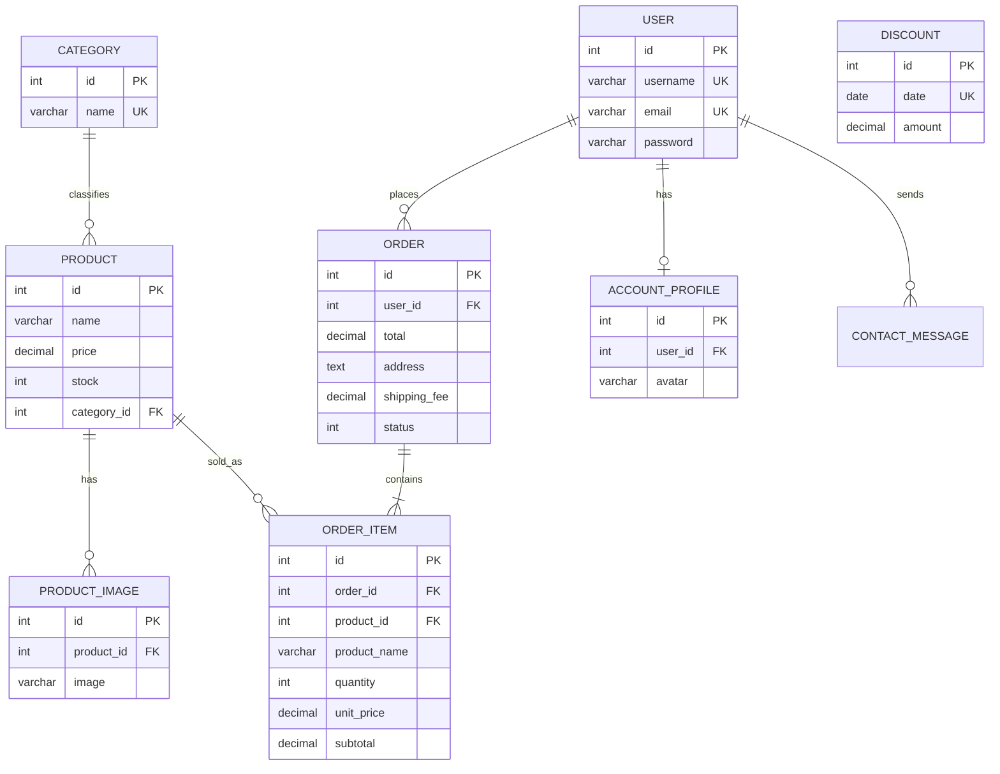

# Django Database Schema

Django migrations under `django_store/store/migrations` define the store tables. Django's built-in authentication, session, and admin migrations define the framework tables.

## Notes

- Passwords use Django's password hashers and authentication framework.
- Product/order money fields use fixed-precision `DECIMAL`.
- Django ORM relations create database foreign keys. Order items retain the product name and unit price for historical display.
- SQLite is the default local database. The existing CodeIgniter database is not automatically imported by Django migrations; back up and plan a separate data migration before using old production data.